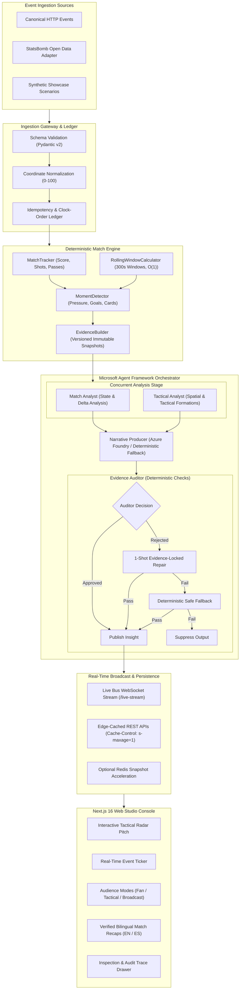

# MatchPulse

[](https://github.com/Git-ARoy/MatchPulse/actions/workflows/deploy.yml)
[](https://fastapi.tiangolo.com)
[](https://nextjs.org/)
[](https://www.python.org/)
[](https://www.typescriptlang.org/)
[](https://learn.microsoft.com/)
[](https://kubernetes.io/)

**MatchPulse** is an evidence-first football intelligence platform designed for high-integrity, real-time match analytics. The platform ingests source-agnostic event streams, calculates deterministic spatial and temporal match state, triggers multi-agent investigative workflows upon detecting tactical momentum shifts, and serves cryptographically grounded, audience-personalized match insights.

Unlike speculative generative sports applications, MatchPulse enforces a strict boundary: **mathematical arithmetic and factual ground truths are strictly calculated in deterministic code**, while AI agents are strictly utilized for qualitative narrative synthesis, tactical interpretation, and editorial personalization under automated deterministic audit.

---

## Table of Contents

- [System Design & Architecture](#system-design--architecture)
  - [Architectural Principles](#architectural-principles)
  - [Logical System Flow](#logical-system-flow)
  - [Data Pipeline & Event Lifecycle](#data-pipeline--event-lifecycle)
- [Deterministic Analytics & Metrics](#deterministic-analytics--metrics)
  - [Pressure Index (`pressure-v1`)](#pressure-index-pressure-v1)
  - [Significant Moment Triggers](#significant-moment-triggers)
- [Multi-Agent Orchestration Architecture](#multi-agent-orchestration-architecture)
  - [Workflow Stages & Concurrency](#workflow-stages--concurrency)
  - [Audit, One-Shot Repair & Suppression Safeguards](#audit-one-shot-repair--suppression-safeguards)
- [Next.js Studio Console & Visualization](#nextjs-studio-console--visualization)
- [Codebase State & Structure](#codebase-state--structure)
  - [Directory Structure](#directory-structure)
  - [Verification & Quality Assurance](#verification--quality-assurance)
- [API v1 Specification](#api-v1-specification)
  - [Core Endpoints](#core-endpoints)
  - [Idempotency & Ingestion Guarantees](#idempotency--ingestion-guarantees)
- [DevOps & Cloud Infrastructure](#devops--cloud-infrastructure)
  - [Continuous Integration & Continuous Deployment (CI/CD)](#continuous-integration--continuous-deployment-cicd)
  - [Kubernetes Hardening & Topologies](#kubernetes-hardening--topologies)
  - [Containerization & Helm Packaging](#containerization--helm-packaging)
  - [Configuration & Environment Reference](#configuration--environment-reference)
- [Synthetic Demo Data & Compliance Policy](#synthetic-demo-data--compliance-policy)

---

## System Design & Architecture

### Architectural Principles

1. **Source Independence (`event-v1`):** All event sources are normalized into an immutable, canonical contract with unified `(0..100, 0..100)` pitch coordinates and standardized match clocks. Internal analytics engines remain completely agnostic of third-party telemetry schemas.
2. **Deterministic Facts, AI Interpretation:** Match statistics, xG, possession ratios, scorelines, and momentum swings are computed using deterministic algorithms. Large Language Models never act as statistical calculators.
3. **Evidence-First Publication:** Every published insight must embed immutable evidence packages consisting of precise source event IDs, chronological time windows, state sequence versions, and passed audit check assertions.
4. **Specialized Stage Isolation:** Agent roles (Match Analyst, Tactical Analyst, Narrative Producer, Evidence Auditor) execute with strictly segregated prompts, contextual boundaries, and typed schemas.
5. **Deterministic Auditing & Fail-Safe Fallbacks:** Any generated prose that misstates computed metrics, references unverified events, or violates factual bounds is rejected. A one-shot evidence-locked repair runs; if verification fails again, the engine automatically falls back to deterministic templates or completely suppresses the output.
6. **Observable Orchestration:** Full execution traces—including per-agent latencies, raw outputs, validation reports, and circuit breaker decisions—are queryable via dedicated audit APIs without leaking secrets or system prompts.

### Logical System Flow



### Data Pipeline & Event Lifecycle

1. **Ingest & Normalize:** An inbound event arrives via `/api/v1/matches/{match_id}/events` or batch endpoint. Event coordinates are mapped to standard percentual values `[0, 100]`.
2. **Ledger Validation:** The in-memory ledger verifies idempotency:
   - Same `event_id` + identical payload $\rightarrow$ `200 OK` (`duplicate: true`).
   - Same `event_id` + conflicting payload $\rightarrow$ `409 Conflict`.
   - Out-of-order match clock timestamp $\rightarrow$ `409 Conflict`.
3. **State Mutation:** `MatchTracker` updates running match totals (score, pass completion rates, zonal counts, fouls, cards).
4. **Rolling Window Accounting:** `RollingWindowCalculator` updates two adjacent 300-second FIFO queues in amortized $\mathcal{O}(1)$ time.
5. **Moment Detection:** `MomentDetector` evaluates if any threshold condition is satisfied.
6. **Agent Orchestration:** Upon trigger, an `EvidencePackage` is bound to the current `state_version` and handed to the Microsoft Agent Framework coordinator.
7. **Broadcast:** The verified insight, updated state snapshot, and event payload are published atomically across all subscribed WebSocket connections via `live_bus`.

---

## Deterministic Analytics & Metrics

### Pressure Index (`pressure-v1`)

The MatchPulse Pressure Index is a deterministic composite metric evaluating team attacking momentum over a trailing 5-minute (300-second) window:

$$\text{Pressure Index} = \min\Big(100,\; 15 \cdot A + 25 \cdot R + 20 \cdot B + 25 \cdot S + 15 \cdot P\Big)$$

Where:
- $A$: Attacking-third entries within the rolling window.
- $R$: High regains won in the opposition half.
- $B$: Penalty-box entries.
- $S$: Total shots taken and goals scored.
- $P$: Active defensive pressure events executed.

### Significant Moment Triggers

`MomentDetector` evaluates the following conditions after every state transition (with an enforced 3-minute cooldown per moment type to prevent duplicate cascade triggers):

| Moment Type | Trigger Condition | Evidence Scope |
|---|---|---|
| `pressure_shift` | $|\Delta \text{Pressure Index}| > 25$ relative to preceding 5-min window | Trailing 300 seconds across both teams |
| `goal` | Confirmed goal event | Scoring sequence and lead-up possession |
| `red_card` | Direct red card or second yellow dismissal | Infraction event and preceding tactical phase |
| `shot_burst` | $\ge 3$ shots within a single 5-minute rolling window | All shot events and preceding offensive build-up |
| `possession_swing` | $> 15\%$ delta in possession ratio between rolling windows | Rolling window duel and pass sequences |

---

## Multi-Agent Orchestration Architecture

MatchPulse implements a multi-stage workflow powered by the **Microsoft Agent Framework** (`agent-framework-core`). Every stage operates against an immutable, versioned evidence snapshot.

```
       ┌──────────────────────────────────────────────────────────┐
       │             Evidence Snapshot (state_version)            │
       └─────────────┬──────────────────────────────┬─────────────┘
                     │                              │
                     ▼                              ▼
        ┌─────────────────────────┐    ┌─────────────────────────┐
        │      Match Analyst      │    │    Tactical Analyst     │
        │    (Metric & Deltas)    │    │ (Formations & Spatial)  │
        └────────────┬────────────┘    └────────────┬────────────┘
                     │                              │
                     └──────────────┬───────────────┘
                                    ▼
                      ┌───────────────────────────┐
                      │    Narrative Producer     │
                      │  Azure Foundry / Fallback │
                      └─────────────┬─────────────┘
                                    ▼
                      ┌───────────────────────────┐
                      │     Evidence Auditor      │
                      │   (Deterministic Audit)   │
                      └───────┬───────────┬───────┘
                              │           │
                     Approved │           │ Rejected
                              ▼           ▼
                      ┌───────────────┐ ┌───────────────────────┐
                      │ Publish Story │ │ 1-Shot Evidence-Bound │
                      └───────────────┘ │        Repair         │
                                        └───────────┬───────────┘
                                                    │
                                           Approved │ Rejected
                                                    ▼
                                        ┌───────────────────────┐
                                        │  Safe Fallback / Drop │
                                        └───────────────────────┘
```

### Workflow Stages & Concurrency

1. **Concurrent Specialist Stage (`asyncio.gather`):**
   - **Match Analyst:** Ingests metric deltas, scoreline alterations, and possession shares. Synthesizes measured quantitative shifts.
   - **Tactical Analyst:** Assesses spatial heatmaps, zonal territory occupancy, turnover locations, and passing network channels.
2. **Narrative Producer:** Combines structured findings from both specialists into audience-adapted prose (fan headlines, tactical summaries, broadcast lower-thirds). Utilizes Microsoft Foundry models when configured, guarded by an **800 ms circuit breaker**. If the platform is unavailable or times out, execution seamlessly falls back to the deterministic narrative generator.
3. **Evidence Auditor:** A deterministic verification engine that subjects generated narrative content to rigid ground-truth verification checks.

### Audit, One-Shot Repair & Suppression Safeguards

The `EvidenceAuditor` executes five deterministic verification checks:
- **Event ID Verification:** Confirms every cited event ID exists in the immutable evidence window.
- **Metric Fidelity Check:** Confirms stated numbers (e.g. pressure indices, shot counts) match engine outputs exactly.
- **Clock Alignment Check:** Validates that the moment timestamp corresponds with the match state clock.
- **Scoreline Integrity:** Verifies home and away goal counts reflect recorded goal events.
- **Zonal Geometry Check:** Validates spatial assertions against canonical pitch coordinates.

If an audit failure occurs:
1. **One-Shot Repair:** The orchestrator initiates one automated repair strictly re-grounded in the immutable evidence package.
2. **Deterministic Safe Fallback:** If the repaired output still fails audit, the engine discards the model prose and emits a pre-validated, evidence-locked deterministic insight.
3. **Suppression:** If the underlying evidence package itself fails audit checks, the insight is completely suppressed. Hallucinations never reach the user interface.

---

## Next.js Studio Console & Visualization

The frontend is a production-grade **Next.js 16** (App Router) console built with React 19, TypeScript, and Microsoft Fluent UI.

- **Interactive Tactical Radar:** Real-time canvas/SVG football pitch displaying player coordinates, zonal divisions (defensive third, middle third, attacking third, penalty box), and event vectors.
- **Live Event Ticker:** Low-latency feed consuming the backend WebSocket stream (`/api/v1/matches/{match_id}/live-stream`) with automatic reconnection and initial REST state synchronization.
- **Multi-Audience Personalization Bar:**
  - **Fan Mode:** Accessible, engaging storytelling highlighting momentum swings and drama.
  - **Analyst Mode:** Dense tactical breakdowns with quantitative metrics, xG calculations, and spatial heat patterns.
  - **Broadcast Overlay:** Minimalist TV lower-third tickers designed for live production environments.
- **Bilingual Verified Recaps:** Generates audience-targeted match summaries in English and Spanish (`/api/v1/matches/{match_id}/recap`), completely grounded in verified insight ledger items.
- **Audit & Trace Drawer:** Allows analysts to inspect agent execution traces, step durations, auditor verification checks, and raw telemetry provenance.
- **Enterprise Authentication:** Configured with **Auth.js (NextAuth v5)** supporting Google OAuth and secure operator credentials.

---

## Codebase State & Structure

### Directory Structure

```text
MatchPulse/
├── .github/
│   └── workflows/
│       └── deploy.yml              # CI/CD: lint, pytest, next build, k8s dry-run, GHCR, AKS
├── backend/
│   ├── app/
│   │   ├── adapters/               # Source adapters (StatsBomb Open Data)
│   │   ├── agents/                 # Microsoft Agent Framework contracts & roles
│   │   │   ├── contracts.py        # EvidenceContext and agent payload definitions
│   │   │   ├── deterministic_roles.py # Deterministic Match & Tactical Analysts
│   │   │   └── foundry_provider.py # Microsoft Foundry narrative adapter
│   │   ├── analytics/              # Deterministic analytics engine
│   │   │   ├── evidence_builder.py # Evidence window snapshot constructor
│   │   │   ├── match_tracker.py    # Match state, score, and box stats tracker
│   │   │   ├── moment_detector.py  # Significant moment detection & cooldowns
│   │   │   └── rolling_windows.py  # O(1) two-window 300s rolling metric calculators
│   │   ├── dev/                    # Synthetic scenarios and deterministic fixtures
│   │   ├── domain/                 # Canonical domain schemas (Pydantic v2)
│   │   │   ├── analysis_runs.py    # Orchestration execution run models
│   │   │   ├── events.py           # Canonical event-v1 model & pitch coordinates
│   │   │   ├── insights.py         # Insight, evidence, and audit verification models
│   │   │   └── match_state.py      # Core match state representations
│   │   ├── orchestration/          # Multi-agent coordination
│   │   │   └── coordinator.py      # Agent Framework workflow, repair, & fallback
│   │   ├── services/               # Core business services
│   │   │   ├── evidence_auditor.py # 5-stage deterministic validation engine
│   │   │   ├── insight_generator.py# Deterministic narrative generator
│   │   │   ├── live_bus.py         # Async PubSub WebSocket event bus
│   │   │   ├── match_service.py    # Ingestion coordinator & ledger management
│   │   │   └── redis_cache.py      # Optional Redis distributed state cache
│   │   ├── schemas/                # Public API request and response models
│   │   └── main.py                 # FastAPI application, routing, and middleware
│   ├── tests/                      # Automated test suite (42 unit & integration tests)
│   ├── Dockerfile                  # Multi-stage hardened Python 3.11 container
│   └── pyproject.toml              # Dependencies, package metadata, & pytest config
├── frontend/
│   ├── app/                        # Next.js 16 App Router pages
│   │   ├── api/auth/               # NextAuth v5 authentication handlers
│   │   ├── dashboard/              # MatchPulse Studio Console
│   │   ├── match/[id]/analysis/    # Deep-dive tactical analysis view
│   │   └── layout.tsx              # Root Fluent UI & Auth provider layout
│   ├── src/
│   │   ├── components/             # UI components
│   │   │   ├── dashboard/          # Broadcast overlays, recaps, personalization
│   │   │   ├── landing/            # Landing page hero, interactive previews
│   │   │   └── radar/              # Tactical pitch & auto-eventing feed
│   │   └── lib/                    # API client & WebSocket subscription manager
│   ├── auth.ts                     # Auth.js configuration
│   ├── Dockerfile                  # Multi-stage standalone Node.js 22 container
│   └── package.json                # Next.js, React 19, & Fluent UI dependencies
├── helm/
│   └── matchpulse/                 # Production Helm 3 packaging chart
│       ├── Chart.yaml
│       └── values.yaml
├── k8s/                            # Production-hardened Kubernetes manifests
│   ├── backend-deployment.yaml     # API Deployment (3 replicas, read-only root)
│   ├── frontend-deployment.yaml    # Web Deployment (2 replicas, non-root)
│   ├── hpa.yaml                    # Horizontal Pod Autoscalers (CPU/Memory 70%)
│   ├── ingress.yaml                # NGINX Ingress with TLS & WebSocket timeouts
│   ├── pdb.yaml                    # Pod Disruption Budgets (minAvailable: 1)
│   └── services.yaml               # ClusterIP Services for API and Web
├── docs/                           # Architecture, API specifications, & requirements
└── docker-compose.yml              # Container orchestration reference
```

### Verification & Quality Assurance

The codebase includes comprehensive automated test coverage validating event parsing, coordinate transformation, out-of-order rejection, concurrent agent workflows, and auditor repair semantics.

- **Automated Test Suite:** 42 passed test cases in pytest.
- **Coverage Areas:**
  - `test_events_and_analytics.py`: Event validation, rolling windows, pressure index calculations.
  - `test_api_pipeline.py`: REST endpoints, idempotency, batch partial acceptance, WebSocket broadcasting.
  - `test_statsbomb_adapter.py`: Ingestion and mapping of open data fixtures into canonical format.
  - `test_comprehensive.py`: End-to-end multi-agent pipeline, one-shot repairs, circuit breakers, and trace audits.

---

## API v1 Specification

### Core Endpoints

| Method | Endpoint | Description | Idempotency / Status Codes |
|---|---|---|---|
| `GET` | `/api/v1/health` | Service health status | `200 OK` |
| `GET` | `/api/v1/health/liveness` | Kubernetes liveness probe | `200 OK` |
| `GET` | `/api/v1/health/readiness` | Kubernetes readiness probe | `200 OK` |
| `POST` | `/api/v1/matches/{match_id}/events` | Ingest single canonical event | `200 OK` (processed/duplicate), `409` (conflict), `422` (schema) |
| `POST` | `/api/v1/matches/{match_id}/events:batch`| Ingest batch of canonical events | Partial acceptance: `200 OK` with per-event error lists |
| `GET` | `/api/v1/matches/{match_id}/state` | Get current match state snapshot | `200 OK`, `404 Not Found` (edge-cached) |
| `GET` | `/api/v1/matches/{match_id}/events` | Read chronological event ledger | `200 OK`, pagination supported via `limit` / `after` |
| `WS` | `/api/v1/matches/{match_id}/live-stream`| Real-time WebSocket event & insight stream | WebSocket protocol |
| `GET` | `/api/v1/matches/{match_id}/insights` | List verified insights for match | `200 OK`, `404 Not Found` |
| `GET` | `/api/v1/insights/{insight_id}` | Retrieve specific insight details | `200 OK`, `404 Not Found` |
| `GET` | `/api/v1/insights/{insight_id}/evidence`| Retrieve immutable evidence package | `200 OK`, `404 Not Found` |
| `GET` | `/api/v1/matches/{match_id}/recap` | Get verified match recap (EN / ES) | `200 OK`, params: `audience=fan\|analyst\|broadcast`, `language=en\|es` |
| `GET` | `/api/v1/analysis-runs/{run_id}/trace` | Inspect agent execution trace & audit | `200 OK`, returns stage latencies & check results |
| `GET` | `/api/v1/demo/scenarios` | List authored synthetic scenarios | `200 OK` |
| `POST` | `/api/v1/demo/scenarios/{id}` | Execute synthetic showcase sequence | `200 OK`, `409 Conflict` (if already executed) |
| `POST` | `/api/v1/import/statsbomb/{id}` | Import historical StatsBomb match | `200 OK`, historical marker applied |

### Idempotency & Ingestion Guarantees

- **Single Event Ingestion:**
  - Returns `200 OK` with `duplicate: true` when re-submitting an identical event ID with an identical payload.
  - Returns `409 Conflict` with `code: EVENT_CONFLICT` if an event ID is re-submitted with differing attributes.
  - Returns `409 Conflict` with `code: EVENT_OUT_OF_ORDER` if an event timestamp is prior to the match clock's latest accepted event.
- **Batch Event Ingestion:**
  - Evaluated chronologically. Structural validity returns `200 OK` with an `errors` array capturing specific rejected items while accepting valid sequence items.
  - Malformed request structures fail fast with `422 Unprocessable Content`.

---

## DevOps & Cloud Infrastructure

MatchPulse is architected for automated cloud deployments adhering to **zero-trust container security** and **cloud-native scalability**.

### Continuous Integration & Continuous Deployment (CI/CD)

The GitHub Actions workflow (`.github/workflows/deploy.yml`) implements a 3-stage promotion pipeline:

```text
[ Push / PR to main ]
         │
         ▼
┌────────────────────────────────────────────────────────┐
│ Stage 1: Quality Gate & Verification                   │
│ • Python 3.11 environment & pytest test execution      │
│ • Node.js 22 Next.js production build check            │
│ • Kubectl client dry-run manifest validation           │
└────────────────────────┬───────────────────────────────┘
                         │ (Success on main push)
                         ▼
┌────────────────────────────────────────────────────────┐
│ Stage 2: Multi-Stage Container Packaging               │
│ • Build & tag API image (ghcr.io/.../matchpulse-api)   │
│ • Build & tag Web image (ghcr.io/.../matchpulse-web)   │
│ • Publish to GitHub Container Registry (GHCR)          │
└────────────────────────┬───────────────────────────────┘
                         │ (If Azure secrets configured)
                         ▼
┌────────────────────────────────────────────────────────┐
│ Stage 3: Azure Kubernetes Service (AKS) Deployment    │
│ • Authenticate via Azure Service Principal / OIDC      │
│ • Set AKS cluster context                              │
│ • Apply manifests & await rolling update rollout       │
└────────────────────────────────────────────────────────┘
```

### Kubernetes Hardening & Topologies

Manifests in `k8s/` implement enterprise security benchmarks:

- **Pod Security Standards:**
  - Non-root user execution (`runAsUser: 10001`, `runAsNonRoot: true`).
  - Read-only root filesystem (`readOnlyRootFilesystem: true`).
  - Linux capabilities dropped completely (`drop: ["ALL"]`).
  - System call filtering enabled via `seccompProfile: { type: RuntimeDefault }`.
  - Privilege escalation disabled (`allowPrivilegeEscalation: false`).
- **High Availability & Zero Downtime:**
  - Rolling update strategy (`maxSurge: 1`, `maxUnavailable: 0`).
  - Pod Disruption Budgets (`k8s/pdb.yaml`) ensure `minAvailable: 1` during node maintenance.
  - Default scaling: 3 API replicas, 2 Web replicas.
- **Dynamic Autoscaling (HPA):**
  - Backend API: Scales dynamically from 3 to 20 pods based on 70% target CPU and Memory utilization.
  - Frontend Web: Scales from 2 to 10 pods based on 70% target CPU utilization.
- **Ingress & WebSocket Proxy Tuning:**
  - NGINX Ingress controller with automated TLS issuance via `cert-manager` (Let's Encrypt).
  - Explicit 3600-second read/send proxy timeouts to maintain persistent WebSocket streams without premature disconnects.

### Containerization & Helm Packaging

- **Backend Container (`backend/Dockerfile`):** Multi-stage build based on `python:3.11-slim`, utilizing pre-compiled wheels, dedicated unprivileged `matchpulse` user, and lightweight runtime footprint.
- **Frontend Container (`frontend/Dockerfile`):** Multi-stage build utilizing `node:22-alpine`, building Next.js in standalone mode to yield an ultra-compact production container.
- **Helm 3 Chart (`helm/matchpulse`):** Provides a parameterized packaging format for deploying MatchPulse across development, staging, and production clusters.

### Configuration & Environment Reference

#### Backend Configuration

| Environment Variable | Description | Default / Required |
|---|---|---|
| `MATCHPULSE_ENV` | Application environment (`development`, `production`) | `production` |
| `MATCHPULSE_LOG_LEVEL` | Logging verbosity (`DEBUG`, `INFO`, `WARNING`) | `INFO` |
| `MATCHPULSE_CORS_ORIGINS` | Permitted CORS origins (comma-separated) | `http://localhost:3000` |
| `REDIS_URL` | Redis snapshot cache connection string | Optional (in-memory if unset) |
| `MATCHPULSE_NARRATIVE_PROVIDER` | Narrative generator provider (`foundry`, `deterministic`) | `deterministic` |
| `FOUNDRY_PROJECT_ENDPOINT` | Azure AI Foundry project endpoint URI | Optional (required for Foundry) |
| `FOUNDRY_MODEL` | Azure AI Foundry deployment model identifier | Optional (e.g. `gpt-4o-mini`) |
| `STATSBOMB_OPEN_DATA_ROOT` | Path to cloned StatsBomb Open Data repository | Optional (for historical import) |

#### Frontend Configuration

| Environment Variable | Description | Default / Required |
|---|---|---|
| `NEXT_PUBLIC_API_URL` | Public base URL of the FastAPI backend | `http://localhost:8000` |
| `AUTH_SECRET` | NextAuth session encryption secret key | **Required** in production |
| `AUTH_CREDENTIALS_EMAIL` | Controlled operator email address | Optional (for credentials login) |
| `AUTH_CREDENTIALS_PASSWORD` | Controlled operator password | Optional (for credentials login) |
| `GOOGLE_CLIENT_ID` | Google OAuth Client ID | Optional (for OAuth sign-in) |
| `GOOGLE_CLIENT_SECRET` | Google OAuth Client Secret | Optional (for OAuth sign-in) |

---

## Synthetic Demo Data & Compliance Policy

MatchPulse strictly complies with intellectual property, sports data licensing, and data provenance guidelines:

1. **No Live Proprietary Scraping:** MatchPulse does not scrape, redistribute, or replicate live proprietary data feeds from the Premier League or commercial data providers.
2. **Synthetic Event Generation:** The interactive showcase scenarios (`momentum-surge`, `quiet-period`, `tactical-stalemate`) are authored, football-realistic synthetic sequences.
3. **Open Research Data Adapters:** The historical data importer (`StatsBombOpenDataAdapter`) interfaces exclusively with open-source research datasets (such as Hudl/StatsBomb Open Data) and explicitly tags imported matches as non-live historical archives.
4. **Deterministic Factuality:** LLMs are strictly forbidden from fabricating match events, timestamps, or statistics. All numbers displayed in the platform originate from the deterministic state ledger.

---

<p align="center">
  <b>MatchPulse Engineering</b> • Evidence-First Football Intelligence
</p>
